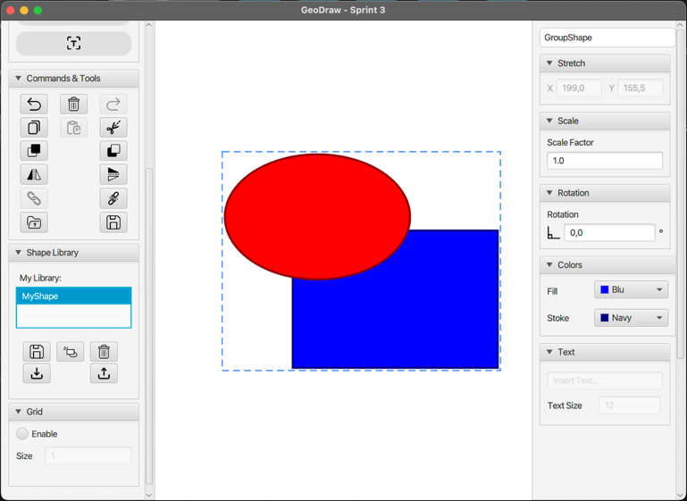
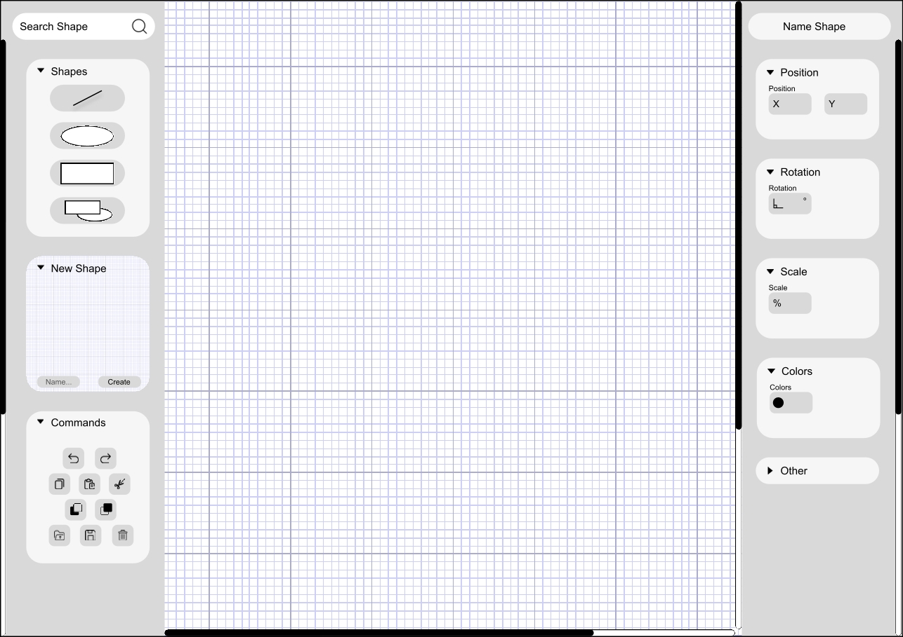
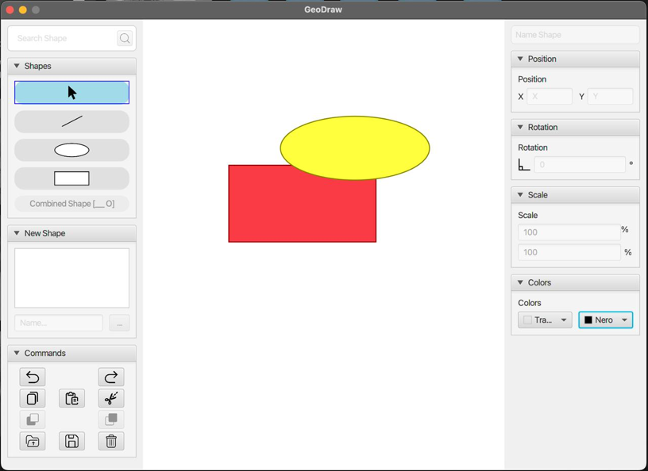
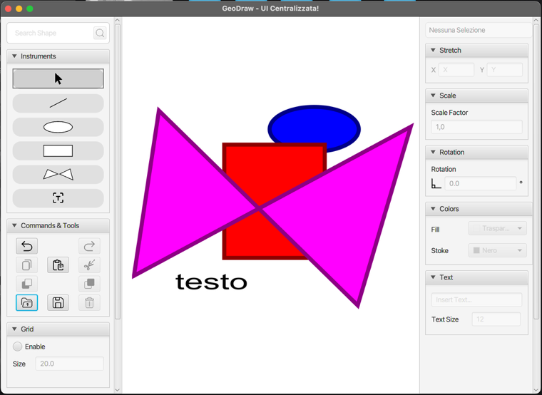
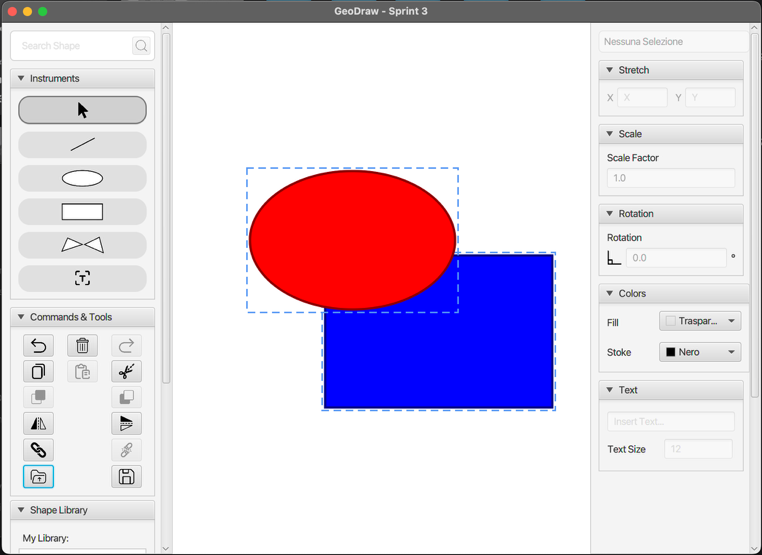

# GeoDraw

**A desktop vector drawing application built with Java and JavaFX, designed around MVC and nine GoF design patterns and developed in three Scrum sprints.**

Project work for the *Software Architecture Design* course, MSc in Computer Engineering, University of Salerno (A.Y. 2024/2025), Group 11.


-6f42c1)

<p align="center">
  
</p>

---

## Features

**Drawing**
- Line segments, rectangles, ellipses, arbitrary polygons and text, drawn with click-and-drag on the canvas
- Stroke and fill colour, text content and font size

**Editing**
- Select, move, resize, rotate, stretch and mirror (horizontal and vertical) any shape
- Cut, copy and paste
- Bring to front and send to back (z-order)
- Group and ungroup: a group behaves like a single shape for every operation
- Unlimited **undo/redo** for every operation that changes the drawing

**Canvas**
- Zoom in and out, scrollable drawing area
- Optional alignment grid with configurable size

**Persistence and reuse**
- Save and load drawings to file
- **Reusable shapes**: save any shape or group to a personal library, insert it again with one click, and export or import whole libraries

## Architecture

The application follows **MVC**. The Model never references JavaFX, so the domain can be tested and reused without any graphics toolkit.

| Layer | Package | Responsibility |
|---|---|---|
| Model | `Model`, `Model.geometry` | `Drawing` and the `Shape` hierarchy, plus pure geometry types (`Point2D`, `Vector2D`, `Rect`, `ColorData`) |
| Controller | `Controller` | `GeoEngine` translates user input into commands; one `ToolState` per drawing tool |
| View | `View` | `DrawingView` and `CanvasPanel`; `JavaFXShapeRenderer` draws the model on a JavaFX `Canvas` |
| Infrastructure | `Infrastructure` | Commands, `CommandManager` (undo/redo stacks), `Clipboard` |
| Persistence | `Persistence` | Serializers for drawings and shape libraries behind a single `PersistenceController` |

### Design patterns

| Pattern | Where | Why |
|---|---|---|
| **Observer** | `Drawing` → `DrawingView` | The view redraws when the model changes, with no polling |
| **State** | `SelectState`, `LineState`, `RectangleState`, … | Each tool handles its own mouse events, with no `switch` on the active tool |
| **Command** | `AddShapeCommand`, `MoveShapeCommand`, … + `CommandManager` | Every change is an object with `execute()`/`undo()`, which gives undo/redo |
| **Factory Method** | `ShapeFactory` | Creates concrete shapes from the tool's parameters |
| **Prototype** | `Shape.clone()` | Copy/paste, the clipboard and reusable shapes |
| **Singleton** | `Clipboard` | One shared clipboard for cut/copy/paste |
| **Composite** | `GroupShape` | Groups and single shapes share the same `Shape` interface |
| **Visitor** | `ShapeVisitor` / `JavaFXShapeRenderer` | Keeps rendering in the View and JavaFX out of the Model |
| **Facade** | `PersistenceController` | Hides the two serializers from `GeoEngine` |

Each pattern has a PlantUML class diagram in [`GeoDraw/pattern/`](GeoDraw/pattern), and every sprint folder contains the full class diagram (`documentation/`).

## Development process

The project ran in **Scrum**: a pre-game phase and three sprints, tracked on Trello with burndown charts, reviews and retrospectives.

- **Pre-game**: Definition of Done, a product backlog of 34 user stories written as *"As a user I want … so that …"* with Given/When/Then acceptance criteria, a velocity estimate (4 devs × 8 h/week × 0.75 focus factor ≈ 36 SP/sprint), the architecture and a Figma UI mockup.
- **Sprint 1 (34 SP)**: core drawing, colours, save/load, move/resize, cut/copy. Four architectural user stories were added mid-sprint to remove every JavaFX class from the Model.
- **Sprint 2 (32 SP)**: paste, undo/redo, z-order, zoom, scroll, grid, polygons, text, rotation.
- **Sprint 3 (30 SP)**: mirroring, stretching, grouping/ungrouping and the reusable shape library with import/export.

Every user story met the Definition of Done: code review plus unit and integration tests. The final release has **590+ tests** (JUnit 5, Mockito, AssertJ, TestFX).

### From mockup to final release

| Figma mockup | Sprint 1 |
|---|---|
|  |  |
| **Sprint 2** | **Sprint 3** |
|  |  |

## Getting started

**Requirements:** JDK 17 or later and Maven 3.8 or later. JavaFX is pulled in by Maven.

```bash
git clone https://github.com/cescomonda/Soft_Gruppo11.git
cd Soft_Gruppo11/GeoDraw/sprint3
mvn clean javafx:run
```

Run the test suite with:

```bash
mvn test
```

The `sprint1/` and `sprint2/` folders keep the state of the code at the end of each earlier sprint.

## Repository structure

```
Soft_Gruppo11/
├── GeoDraw/
│   ├── sprint1/            # release of Sprint 1 (code + class diagrams)
│   ├── sprint2/            # release of Sprint 2
│   ├── sprint3/            # final release
│   │   └── src/main/java/sad/gruppo11/
│   │       ├── Model/          # shapes, drawing, geometry
│   │       ├── Controller/     # GeoEngine, tool states, shape library
│   │       ├── View/           # rendering and canvas
│   │       ├── Infrastructure/ # commands, undo/redo, clipboard
│   │       ├── Factory/        # ShapeFactory
│   │       └── Persistence/    # serializers
│   └── pattern/            # one PlantUML diagram per design pattern
├── docs/images/            # screenshots used in this README
└── Soft_Gruppo 11.pdf      # full project report (Italian)
```

## Documentation

The full report, [`Soft_Gruppo 11.pdf`](Soft_Gruppo%2011.pdf) (in Italian), covers the product backlog with acceptance criteria, sprint planning and velocity, the architecture and class diagrams, and the review and retrospective of each sprint.

## Team

- **Francesco Ferrara**
- **Leonardo Luongo**
- **Francesco Monda**
- **Alessia Parente**

Supervised by Prof. Pierluigi Ritrovato, University of Salerno.
